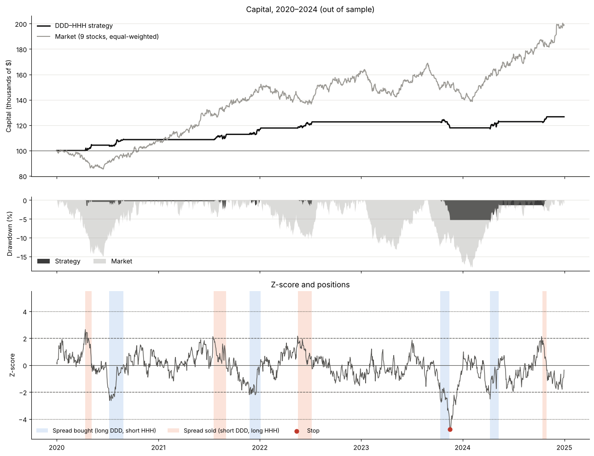
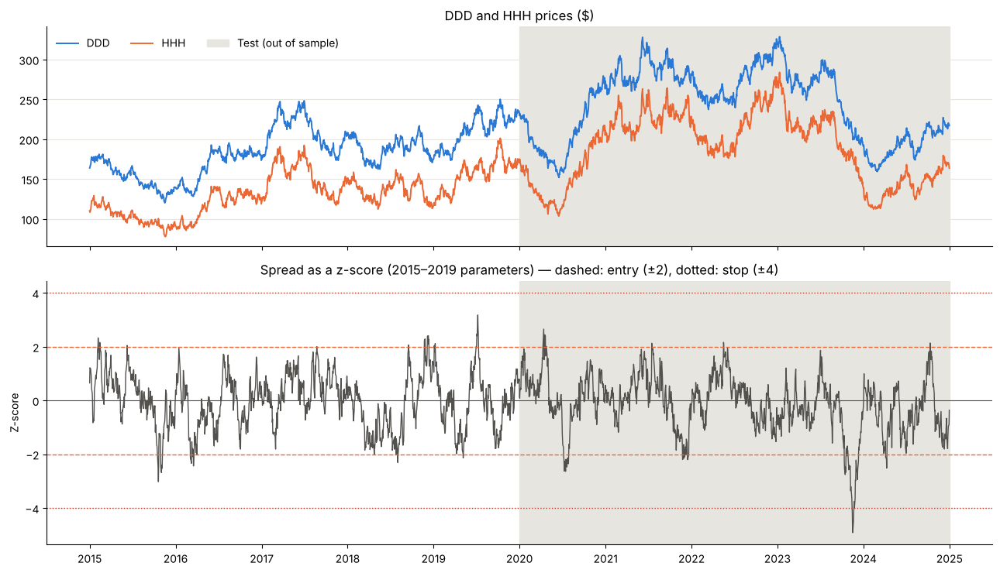

# Pairs Trading: Statistical Arbitrage on Two Cointegrated Stocks

Finding a cointegrated pair among nine stocks (2015–2024) and trading the gap between them. This was a case study for the PolyFinances investment club (Polytechnique Montréal), as part of the team selection for the Rotman International Trading Competition (RITC).

> The data is **synthetic** and was provided by PolyFinances. It does not describe real companies. It is **not included** in this repository.

## Result

The pair, the spread and the trading rules were all fixed using **2015–2019 only**, then applied unchanged to **2020–2024**. Out of sample, the strategy turns \$100,000 into **\$126,597**, with a Sharpe ratio of 1.28, a maximum drawdown of −5.9%, and almost no correlation with the market (0.03).

| DDD–HHH strategy | 2015–2019 (in sample) | **2020–2024 (out of sample)** | Market, 2020–2024 |
|---|---|---|---|
| Total return | +40.6% | **+26.6%** | +99.1% |
| Annualized volatility | 4.5% | **3.7%** | 12.5% |
| Sharpe ratio | 1.54 | **1.28** | 1.16 |
| Maximum drawdown | −4.2% | **−5.9%** | −17.9% |
| Trades (winners) | 10 (10) | **8 (7)** | — |

*Market: equal-weighted portfolio of the nine stocks.*



## Approach

1. **Inspection.** The data is clean: no missing values, duplicates or suspicious jumps. The calendar includes every weekday, holidays included (a sign of synthetic data), so returns are annualized with 261 days.
2. **Pair selection, 2015–2019 only.**
   - All nine log prices are non-stationary (ADF), so cointegration can be tested.
   - Engle-Granger on all 36 pairs, in both directions. With 36 tests, about 2 false positives are expected at 5%, so a Bonferroni correction is applied (p < 0.0014).
   - **DDD–HHH** is the only pair that passes (p ≈ 5 × 10⁻⁶), and Johansen confirms exactly one cointegrating relationship.
   - BBB–CCC passes at 5% but not after correction. It is kept as a control: it is no longer cointegrated in 2020–2024.
3. **Spread.** $\ln(\text{DDD}) - 0.791 \ln(\text{HHH})$, with a half-life of about 14 trading days.
4. **Strategy.**
   - Enter at |z| ≥ 2, exit when z crosses 0, stop at |z| ≥ 4.
   - Signal at the close, executed at the next day's close.
   - 100% of capital as gross exposure, split by the hedge ratio.
   - 0.05% cost per leg.
5. **Evaluation.**
   - A single out-of-sample run on 2020–2024.
   - A placebo test: the same rules on the other 35 pairs give a median Sharpe of 0.13, and 4 pairs wipe out the capital.
   - A sensitivity analysis on costs, borrow fees, thresholds, the stop and yearly re-estimation.



**Key lesson:** the cointegration test is the decision that matters. Any pair can produce a backtest; only the one that is truly cointegrated keeps working on data it has never seen. Correcting for multiple testing is what separates it from a lucky false positive.

## Repository

| File | Content |
|---|---|
| `William_Caron-Bastarache_arbitrage_statistique.ipynb` | Full analysis in French, with outputs (the submission) |
| `pairs_trading_en.ipynb` | English version |
| `requirements.txt` | Python dependencies |
| `images/` | Result charts |

## Running the notebook

The notebooks already contain their outputs, so they can be read on GitHub without running anything.

To run them, place the case study's `data.csv` next to the notebook, then:

```bash
pip install -r requirements.txt
jupyter notebook pairs_trading_en.ipynb
```

Tested with Python 3.13, pandas 3.0, statsmodels 0.15.
